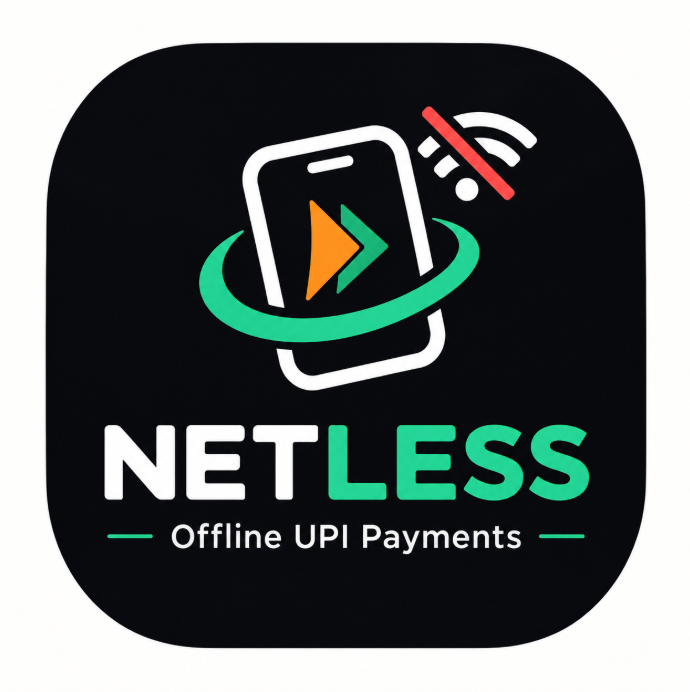
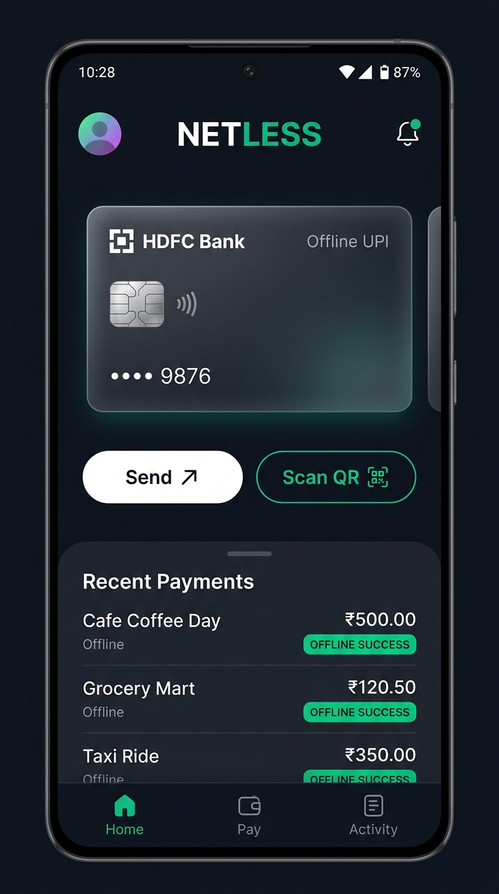
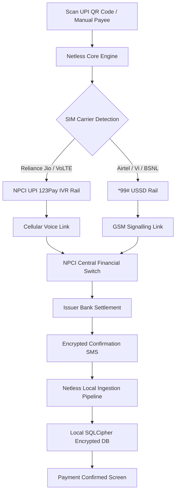

# Netless — Payments Without Internet

<p align="center">
  
</p>

<p align="center">
  <b>100% Offline UPI Payments for Android via NPCI UPI 123Pay & *99# USSD Rails</b><br>
  <i>Send money, scan Bharat/UPI QR codes, and pay contacts anywhere — Zero Cellular Data or Wi-Fi Required.</i>
</p>

<p align="center">
  <a href="https://github.com/AD700-cam/Netless/releases/latest"></a>
  <a href="https://f-droid.org/packages/com.netless.app/"></a>
  <a href="https://www.apache.org/licenses/LICENSE-2.0"></a>
  
  
  
</p>

---

## ⚡ Overview

**Netless** is an open-source, privacy-first Android application that enables standard Unified Payments Interface (UPI) transactions when there is **zero internet connectivity**, spotty mobile coverage, or depleted cellular data packs.

Standard UPI applications (Google Pay, PhonePe, Paytm, BHIM) require continuous, low-latency mobile data to communicate with bank switches. In basement parking lots, rural regions, crowded markets, or during network throttling, transactions inevitably stall or fail.

Netless eliminates this dependency by wrapping National Payments Corporation of India (NPCI) official telecommunication-grade offline payment rails behind a modern, smartphone-native interface:
1. **NPCI UPI 123Pay (Telephony Voice IVR)**: Automated DTMF dialing and structured call management designed to work on all cellular networks including 4G/5G VoLTE (e.g., Reliance Jio).
2. ***99# USSD Infrastructure**: Carrier-level GSM signaling rail for fast payment automation on Airtel, Vi, and BSNL.

---

## 📱 Screenshots

<p align="center">
  
</p>

---

## 🌟 Key Features

- **📶 100% Offline Payment Execution**: Operates exclusively over cellular voice and GSM signaling channels. Not a single internet packet is sent or received.
- **📷 Instant On-Device QR Scanner**: High-performance camera scanner powered by CameraX and ZXing that parses standard Bharat and UPI QR codes entirely on your phone.
- **🔄 Intelligent Dual-Rail Architecture**:
  - **Jio SIMs (All-IP VoLTE)**: Automatically routes through NPCI UPI 123Pay Voice IVR, overcoming Jio's lack of GSM USSD support.
  - **Airtel / Vi / BSNL SIMs**: Direct execution via `*99*1*3#` USSD rapid payment branch.
- **🎙️ Real-Time Call HUD Overlay**: An elegant floating HUD overlay stays with you during automated IVR calls, tracking each stage (*Dialing → Routing → Payee → PIN Confirmation*) so you never lose context.
- **🔒 Zero Internet Permission**: Verified by `AndroidManifest.xml` — `android.permission.INTERNET` is completely absent from the codebase. The app cannot transmit your data externally even if it wanted to.
- **🛡️ Total PIN Isolation**: Netless never prompts for, reads, or stores your secret UPI PIN. PIN entry happens strictly on the encrypted hardware dialer or carrier USSD prompt.
- **🗄️ SQLCipher AES-256 On-Device Storage**: All transaction histories and logs are encrypted locally with hardware-backed keystore integration.
- **⚡ Optional Instant Detection Accessibility Service**: Seamlessly reads carrier USSD dialog results on-device without waiting for delayed SMS delivery.

---

## 🏗️ Architecture & How It Works



### Why Both Rails Are Essential

| Feature | *99# USSD Rail | UPI 123Pay IVR Rail | Standard Online UPI |
| :--- | :--- | :--- | :--- |
| **Carrier Compatibility** | Airtel, Vi, BSNL | **All Carriers (including Jio)** | Requires Internet |
| **Network Type Required** | 2G / GSM Signaling | 2G / 3G / 4G / 5G VoLTE | 4G / 5G / Wi-Fi |
| **Internet Dependency** | **Zero** | **Zero** | 100% Required |
| **Transaction Speed** | ~40–60 seconds | ~30–45 seconds | ~5–10 seconds |
| **Privacy & Telemetry** | **Zero Cloud Tracking** | **Zero Cloud Tracking** | Heavily Profiled |

---

## 🔒 Security & Privacy Model

1. **No Network Socket**: The application does not declare the `android.permission.INTERNET` permission. Android OS physically forbids the application from establishing outbound socket connections.
2. **Encrypted Storage**: Room database is encrypted with SQLCipher using a 256-bit AES key generated and stored inside the Android KeyStore.
3. **SMS Ingestion Scope**: Incoming SMS messages are inspected strictly during an active 40-second transaction window. Netless filters strictly for recognized bank handle headers and never reads personal messages.
4. **Reproducible Builds**: Netless is configured for reproducible builds to guarantee that the distributed binary exactly matches the public source code.

---

## 📦 Installation

### Option 1: F-Droid (Recommended)
Netless is currently submitted for inclusion in the official F-Droid repository.
*F-Droid Repository URL coming soon.*

### Option 2: Direct GitHub Release / Obtainium
You can download the verified, signed production APK directly from GitHub Releases:
1. Navigate to [Releases](https://github.com/AD700-cam/Netless/releases/latest).
2. Download `app-release.apk`.
3. Verify the SHA-256 fingerprint:
   ```bash
   apksigner verify --print-certs app-release.apk
   ```
4. Install directly or track automatic updates using [Obtainium](https://github.com/ImranR98/Obtainium).

---

## 🛠️ Building From Source

### Prerequisites
- Android Studio Ladybug | Hedgehog or Android SDK command-line tools.
- JDK 17 (Eclipse Temurin or Android Studio JBR).
- Android SDK Platforms 29 through 35.

### Steps

```bash
# 1. Clone the repository
git clone https://github.com/AD700-cam/Netless.git
cd Netless

# 2. Set up local Android SDK path (if not defined in environment)
echo "sdk.dir=$ANDROID_HOME" > local.properties

# 3. Build debug APK
./gradlew assembleDebug

# 4. Run unit tests
./gradlew test

# 5. Build signed production release
# Copy keystore template and configure credentials:
cp keystore.properties.example keystore.properties
./gradlew assembleRelease
```

The resulting signed APK will be generated at:
`app/build/outputs/apk/release/app-release.apk`

---

## 📂 Project Structure

```
app/src/main/java/com/netless/app/
├── NetlessApplication.kt              # App process entry & dependency container
├── MainActivity.kt                    # Modern Compose dashboard & quick actions
├── SetupActivity.kt                   # Carrier & bank account registration
├── features/qr_scanner/               # CameraX & ZXing offline QR engine
├── payment/
│   ├── PaymentSessionManager.kt       # State machine orchestrator
│   ├── Upi123CallStringBuilder.kt     # DTMF builder & validator
│   └── sms/SmsTransactionParser.kt    # Pure, context-free bank receipt parser
├── telephony/CallStateCoordinator.kt  # Unified telephony call monitor
├── services/
│   ├── CallOverlayService.kt          # Floating interactive HUD during IVR
│   └── UssdAccessibilityService.kt    # Instant *99# USSD result detection
├── data/                              # Room + SQLCipher encrypted database
└── ui/theme/                          # Zenvest design tokens & Material 3 theme
```

---

## 📄 License & Legal

This project is licensed under the **Apache License 2.0** — see the [LICENSE](LICENSE) and [NOTICE](NOTICE) files for details.

### Disclaimer
*Netless is an independent open-source software project and is not affiliated with, endorsed by, or sponsored by the National Payments Corporation of India (NPCI), Unified Payments Interface (UPI), Reserve Bank of India (RBI), or any commercial banking institution or telecommunication provider.*
